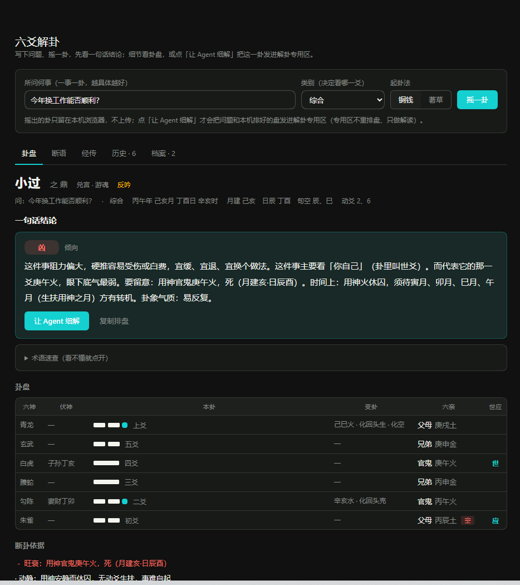

# 六爻解卦 · dsh-liuyao

给 DeepSeek Harness 的六爻纳甲（文王课）起卦与解卦插件：侧栏面板里摇一卦、看一套完整卦盘与白话结论，也可以让我在对话里直接起卦、解卦、查经传。

Six-line I Ching (Liu Yao) casting and reading for DeepSeek Harness: a sidebar panel with the full chart and a plain-language verdict, plus three agent tools.



## 安装

在你自己的 DSH 里（插件 → 添加插件 → 本地目录不行，这里用 GitHub 源）：

```sh
dsh plugin add github:HanQing404/dsh-liuyao
```

桌面版：**插件 → 添加插件**里粘贴 `https://github.com/HanQing404/dsh-liuyao`，或等社区市场收录后在**插件市场**一键安装。

装好后重启（或刷新页面），左侧栏会出现「六爻解卦」。

## 用法

**在面板里自己摇卦**

1. 侧栏点「六爻解卦」；
2. 写下所问之事、选类别（决定取哪一爻为用神）、选起卦法（铜钱 / 蓍草）；
3. 点「摇一卦」：先读「一句话结论」，再看卦盘、断语、经传；「历史」里保留最近 30 次。

**让我起卦解卦**：直接说「帮我起一卦问……」即可。相关工具：

| 工具 | 用途 |
| --- | --- |
| `liuyao_cast` | 随机摇卦并完成整卦分析（也可传你摇好的六爻爻值） |
| `liuyao_analyze` | 解你已经摇好的卦（6/7/8/9，自下而上） |
| `liuyao_lookup` | 查六十四卦经传原文、卦义、八宫表 |

两个起卦工具默认返回 **compact 摘要**（卦名、六亲纳甲、旺衰、用神、依据、应期、趋避、卦辞与动爻，约 260 token）；要逐爻六神、伏神、长生、彖象全文时传 `detail="full"`（约 710 token）。

面板里摇完点「让 Agent 细解」，这一卦会发进**「解卦专用区」**——一个不挂任何工具、跑最低档位的会话。盘面由面板在本机排好，连摘要一起发过去（约 400 token），Agent 直接出结论，**不复现盘面、也不带任何历史**。一卦一个会话：下一次解卦时，上一卦的会话自动归档并出现在面板「档案」页，翻旧账点开就行。

## 断卦做了什么

- **起卦**：铜钱法（老阳/少阴/少阳/老阴 = 1/8、3/8、3/8、1/8）与大衍筮法（1/16、7/16、5/16、3/16）。
- **装卦**：京房八宫与世应、纳甲天干地支（乾纳甲壬、坤纳乙癸）、六亲、六神（依《增删卜易·起六神诀》，自初爻向上）、伏神、旬空、月建、日辰。
- **断法**：按问题类别取用神；月建为主、日辰为辅合参旺衰，考月破、旬空、入墓、暗动；看动爻生克与用神动变（回头生克、进退、化空墓绝、反吟伏吟），给出「吉 / 平 / 凶 / 先吉后散 / 迟滞未散」、应期与趋避。
- **引经**：本卦卦辞、动爻爻辞、彖传、大象，以及变卦卦辞。

## 隐私

- 摇卦记录只存在本机浏览器 localStorage（最多 30 条），不上传、不写入会话；
- 插件不联网、不采集任何数据；
- 只有你点「让 Agent 细解」时，才会把这一卦（问题、类别、六爻爻值、起卦时间）作为一条消息发进你当前打开的对话；「复制排盘」只把文本写进你的剪贴板。

## 数据与许可

- 代码：[MIT](LICENSE)，版权归 HanQing404。
- 六十四卦卦辞、爻辞、彖传、大象与卦义文本整理自[维基文库《周易》](https://zh.wikisource.org/wiki/周易)，该站文字以 **CC BY-SA 4.0** 提供；`engine/classics.json`、`engine/hexagram-meanings.json` 属这部分数据，随包分发时保留署名与相同方式共享。详见 [NOTICE](NOTICE.md)。
- 图标为本插件原创。

## 开发

```powershell
node build-scripts/build-client.mjs   # 改 engine/ 后重建 client.js（内联引擎）
node build-scripts/build-release.mjs  # 生成发布树 release/dsh-liuyao
node --check client.js
```

- `client.template.js` 是面板 UI 与模块外壳，构建时把 `engine/` 内联进去；
- `engine/` 为纯 JS：干支历、八宫纳甲、装卦、用神旺衰、应期、呈现。

已验证：DSH `0.2.2-rc.5`（Windows 桌面版）。声明 `engines.dsh` 之外的版本可装但不保证。

## 免责声明

占卜为传统文化参考，不构成医疗、法律、投资等专业意见；重大决定请以事实与专业判断为准。
